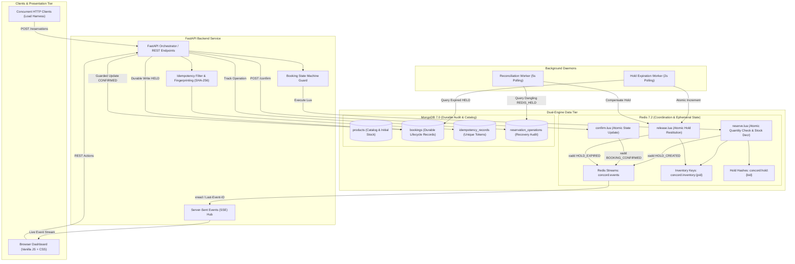
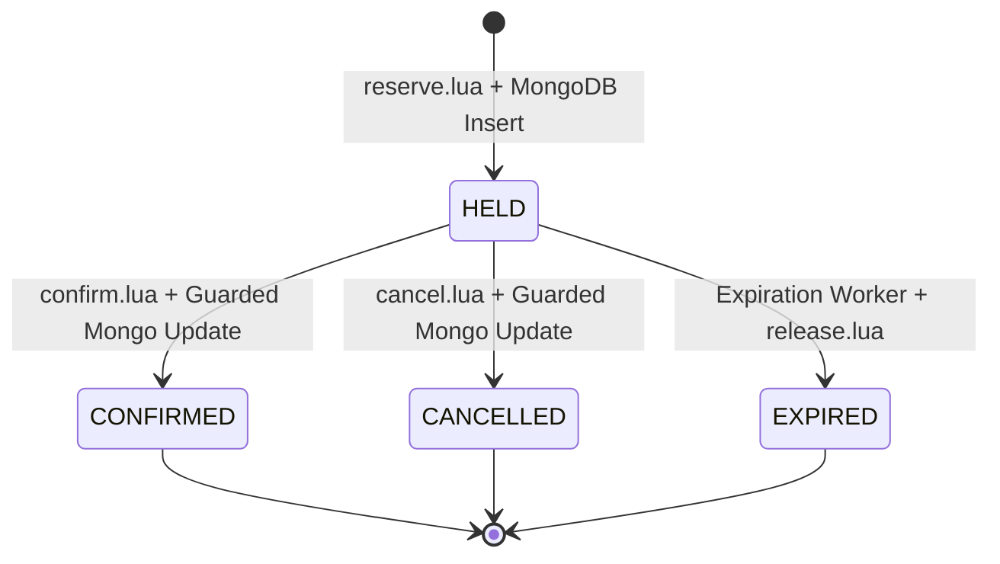

# Concord Technical Architecture Documentation
**A High-Contention Inventory Reservation Service with Exactly-Once Booking Semantics and a Live Contention Stream**

---

## 1. System Architecture Diagram

---

## 2. Component Responsibilities

| Component | Technology | Primary Responsibilities |
| :--- | :--- | :--- |
| **Orchestration Layer** | FastAPI (Python 3.11) | REST API endpoints, Pydantic input validation, idempotency resolution, state-transition guards, SSE streaming, health telemetry. |
| **Durable NoSQL Store** | MongoDB 7.0 | Authoritative persistent storage for catalog items (`products`), booking history (`bookings`), idempotency outcomes (`idempotency_records`), and cross-database operation auditing (`reservation_operations`). Real-time aggregations (`$group`, `$lookup`). |
| **Coordination Store** | Redis 7.2 | Atomic, sub-millisecond stock checks and decrements via Lua scripts, temporary hold tracking, fast lookups, and event ingestion via Redis Streams. |
| **Event Streaming Engine** | Redis Streams + SSE | Append-only log (`concord:events`), live event broadcasting to browser clients with `Last-Event-ID` resume and replay support. |
| **Background Daemons** | Asyncio Background Workers | Scheduled sweepers detecting expired holds past deadlines and reconciling abandoned or crashed in-flight transactions. |

---

## 3. High-Contention Reservation Protocol

### Step-by-Step Request Lifecycle

1. **Client Submission**: Client sends `POST /reservations` containing `product_id`, `quantity`, `idempotency_key`, and optional `hold_ttl_seconds`.
2. **Idempotency Gate**:
   - Computes deterministic SHA-256 fingerprint of `{"product_id": pid, "quantity": qty}`.
   - Atomically attempts to insert `{"idempotency_key": key, "status": "IN_PROGRESS"}` into MongoDB `idempotency_records`.
   - If key already exists:
     - If fingerprint mismatches $\rightarrow$ Reject with `409 Conflict`.
     - If status is `COMPLETED` $\rightarrow$ Return cached original outcome with `cached: true` immediately (no stock decrement).
     - If status is `IN_PROGRESS` $\rightarrow$ Concurrent race; wait briefly or reject with retry recommendation.
3. **Intent Persistence**:
   - Insert operation audit record in `reservation_operations` with status `PENDING_REDIS`.
4. **Atomic Lua Stock Decrement**:
   - Execute `reserve.lua` inside Redis:
     1. Verify key `concord:inventory:{pid}` exists.
     2. Check `stock >= quantity`. If insufficient, emit `RESERVATION_REJECTED` to stream and return failure.
     3. Decrement stock: `decrby concord:inventory:{pid} quantity`.
     4. Save hold hash: `hset concord:hold:{bid} ...`.
     5. Set TTL safety buffer: `expire concord:hold:{bid} (ttl + 120s)`.
     6. Emit `HOLD_CREATED` to stream: `xadd concord:events ...`.
5. **Durable Booking Write**:
   - Insert new booking into MongoDB `bookings` with status `HELD`.
   - Update `reservation_operations` to `COMPLETED`.
6. **Compensation Guard (Crash Protection)**:
   - If the MongoDB write encounters an unrecoverable failure, an immediate compensation rollback is triggered: `release.lua` restores Redis inventory atomically and updates the operation to `COMPENSATED_ROLLED_BACK`.
7. **Idempotency Finalization**:
   - Update `idempotency_records` status to `COMPLETED` storing the exact JSON response payload.
   - Return `201 Created` with booking details and expiration deadline.

---

## 4. Finite State Machine (FSM)

### State Transition Invariant Table
| Current State | Target State | Trigger | Action on Redis Stock | Valid? |
| :--- | :--- | :--- | :--- | :--- |
| `None` | `HELD` | `POST /reservations` | Decrement (`decrby`) | **Yes** |
| `HELD` | `CONFIRMED` | `POST /confirm` | No change (committed) | **Yes** |
| `HELD` | `CANCELLED` | `POST /cancel` | Increment (`incrby`) | **Yes** |
| `HELD` | `EXPIRED` | Worker Sweep | Increment (`incrby`) | **Yes** |
| `CONFIRMED` | `CANCELLED` | User request | Blocked by state guard | **No (400)** |
| `EXPIRED` | `CONFIRMED` | Late user request | Blocked by state guard | **No (400)** |
| `CANCELLED` | `CONFIRMED` | User request | Blocked by state guard | **No (400)** |

---

## 5. Cross-Database Recovery Protocol

### Why Redis and MongoDB Do Not Share 2PC (Two-Phase Commit)
Distributed transactions across different database architectures (Redis in-memory key-value store and MongoDB document store) introduce network bottlenecks, coordinator failure modes, and operational fragility under high contention.

Concord implements a **Saga / Compensation Pattern with Guarded Idempotency**:
1. **Authoritative Active Inventory**: Redis is the single authoritative source of truth for real-time decrement coordination.
2. **Durable System of Record**: MongoDB is the durable source of truth for business audits, long-term aggregations, and financial reconciliation.
3. **Orphan Sweeper**: If a network partition or container failure occurs after Redis decrements stock but before MongoDB records the booking, the `reservation_operations` collection flags the operation as `REDIS_HELD`. The background `reconciliation_worker` inspects dangling operations older than 15 seconds, confirms whether the booking document exists, and if missing, safely restores the Redis stock via `release.lua`.

---

## 6. Live Contention Stream & SSE Reconnection Protocol

1. **Lifecycle Stream**: Every atomic state transition publishes a structured event to Redis Stream `concord:events` using `XADD`.
2. **Server-Sent Events (SSE)**: Browser clients connect via `EventSource` to `/events/stream`.
3. **Reconnection with `Last-Event-ID`**:
   - When a browser disconnects and reconnects, it supplies the HTTP header `Last-Event-ID: <stream_id>`.
   - The SSE service passes this cursor to `XREAD BLOCK concord:events <stream_id>`.
   - Any events that transpired during the disconnection interval are delivered in sequence to the client before returning to live polling.
